# 10.5.8c — DER: Evolución y Perfil

**Área:** Progresión del miembro — Árbol de habilidades, bóveda, marketplace, trofeos y beneficios.  
**Nota:** MIEMBRO aparece simplificado como referencia cruzada (además tiene `xp`, `coins` y `llaves_acero`).

> **Actualizado 17/11 (alineado con la carpeta):** el árbol de habilidades es **colectivo del clan** y se paga con Puntos de Clan (CU-004-002 / RF-015): `NODO_CLAN` guarda el nivel de cada nodo por clan e `INVERSION_NODO` es el historial ("ÚLTIMAS INVERSIONES"). `COFRE` suma `origen` y `llaves_requeridas` (Llaves de Acero); `ITEM.categoria` pasa a SKIN/AURA/ICONO (CU-004-004); `INVENTARIO_ITEMS.activo` (paso 18); los reclamos de beneficios van en `RECLAMO_BENEFICIO` (un beneficio lo reclaman muchos miembros) y `BENEFICIO_ALIADO` suma `categoria`, `destacado` y `fecha_vencimiento` (RF-016). Rangos: BRONCE/PLATA/ORO (10.4.3).

---

```plantuml
@startuml er-evolucion-perfil
hide circle
skinparam linetype ortho
skinparam entity {
  BackgroundColor #242424
  BorderColor #F97316
  FontColor #FFFFFF
  AttributeFontColor #CCCCCC
}
skinparam arrow {
  Color #F97316
}

' ─── Referencia cruzada (simplificada) ────────────────────

entity MIEMBRO {
  * id : UUID <<PK>>
}

' ─── EVOLUCIÓN: SKILL TREE (colectivo del clan, CU-004-002 / RF-015) ───

entity CLAN {
  * id : UUID <<PK>>
  --
  * puntos_clan : INTEGER
}

entity NODO {
  * id : UUID <<PK>>
  --
  * nombre : VARCHAR(100)
  * descripcion : TEXT
  * costo_puntos : INTEGER
  * nivel_maximo : INTEGER DEFAULT 3
  * efecto : VARCHAR(200)
  * bonus_por_nivel : INTEGER
  * estado : ENUM(BLOQUEADO,DISPONIBLE,DESBLOQUEADO)
}

entity NODO_DEPENDENCIA {
  * nodo_id : UUID <<PK,FK>>
  * prerequisito_id : UUID <<PK,FK>>
}

entity NODO_CLAN {
  * clan_id : UUID <<PK,FK>>
  * nodo_id : UUID <<PK,FK>>
  --
  * nivel : INTEGER
}

entity INVERSION_NODO {
  * id : UUID <<PK>>
  --
  * clan_id : UUID <<FK>>
  * nodo_id : UUID <<FK>>
  * miembro_id : UUID <<FK>>
  * nivel_alcanzado : INTEGER
  * costo : INTEGER
  * fecha_inversion : TIMESTAMP DEFAULT NOW()
}

' ─── EVOLUCIÓN: BÓVEDA (CU-004-003) ───────────────────────

entity COFRE {
  * id : UUID <<PK>>
  --
  * miembro_id : UUID <<FK>>
  * rareza : ENUM(COMUN,RARO,EPICO,LEGENDARIO)
  * estado : ENUM(DISPONIBLE,RECLAMADO)
  * origen : ENUM(BOTIN_DIARIO,HITO,GUERRA)
  * llaves_requeridas : INTEGER DEFAULT 0
  * fecha_obtencion : TIMESTAMP DEFAULT NOW()
}

' ─── EVOLUCIÓN: MARKETPLACE (CU-004-004) ──────────────────

entity ITEM {
  * id : UUID <<PK>>
  --
  * nombre : VARCHAR(100)
  * categoria : ENUM(SKIN,AURA,ICONO)
  * precio : INTEGER
  * rareza : ENUM(COMUN,RARO,EPICO,LEGENDARIO)
}

entity INVENTARIO_ITEMS {
  * miembro_id : UUID <<PK,FK>>
  * item_id : UUID <<PK,FK>>
  --
  * fecha_obtencion : TIMESTAMP DEFAULT NOW()
  * activo : BOOLEAN DEFAULT FALSE
}

entity TRANSACCION_MARKETPLACE {
  * id : UUID <<PK>>
  --
  * miembro_id : UUID <<FK>>
  * item_id : UUID <<FK>>
  * fecha : TIMESTAMP DEFAULT NOW()
}

' ─── PERFIL: TROFEOS ──────────────────────────────────────

entity TROFEO {
  * id : UUID <<PK>>
  --
  * miembro_id : UUID <<FK>>
  * nombre : VARCHAR(100)
  * descripcion : TEXT
  * tipo : ENUM(RACHA,CER,CLAN,EVENTO)
  * fecha_obtencion : TIMESTAMP DEFAULT NOW()
}

' ─── PERFIL: BENEFICIOS (CU-005-006 / RF-016) ─────────────

entity ALIADO_COMERCIAL {
  * id : UUID <<PK>>
  --
  * nombre : VARCHAR(100)
  * url_base : VARCHAR(255)
  logo_url : VARCHAR(255)
}

entity BENEFICIO_ALIADO {
  * id : UUID <<PK>>
  --
  * aliado_id : UUID <<FK>>
  * titulo : VARCHAR(150)
  * descripcion : TEXT
  * categoria : VARCHAR(50)
  * tipo : ENUM(CODIGO,REDIRECCION,CUPON,SUSCRIPCION)
  * rango_minimo : ENUM(BRONCE,PLATA,ORO)
  * estado : ENUM(DISPONIBLE,EXPIRADO)
  * destacado : BOOLEAN DEFAULT FALSE
  fecha_vencimiento : TIMESTAMP
}

entity RECLAMO_BENEFICIO {
  * beneficio_id : UUID <<PK,FK>>
  * miembro_id : UUID <<PK,FK>>
  --
  * fecha_reclamo : TIMESTAMP DEFAULT NOW()
}

entity SUSCRIPCION_ACTIVA {
  * id : UUID <<PK>>
  --
  * miembro_id : UUID <<FK>>
  * aliado_id : UUID <<FK>>
  * fecha_inicio : TIMESTAMP DEFAULT NOW()
  * fecha_fin : TIMESTAMP
}

' ─── Relaciones ───────────────────────────────────────────

NODO_DEPENDENCIA }o--|| NODO : "nodo"
NODO_DEPENDENCIA }o--|| NODO : "requiere"
NODO_CLAN }o--|| CLAN : "nivel en"
NODO_CLAN }o--|| NODO : "de"
INVERSION_NODO }o--|| CLAN : "del clan"
INVERSION_NODO }o--|| NODO : "sobre"
INVERSION_NODO }o--|| MIEMBRO : "realizada por"
MIEMBRO }o--|| CLAN : "pertenece a"

COFRE }o--|| MIEMBRO : "pertenece a"

INVENTARIO_ITEMS }o--|| MIEMBRO : "de"
INVENTARIO_ITEMS }o--|| ITEM : "contiene"
TRANSACCION_MARKETPLACE }o--|| MIEMBRO : "realizada por"
TRANSACCION_MARKETPLACE }o--|| ITEM : "sobre"

TROFEO }o--|| MIEMBRO : "obtenido por"

BENEFICIO_ALIADO }o--|| ALIADO_COMERCIAL : "provisto por"
RECLAMO_BENEFICIO }o--|| BENEFICIO_ALIADO : "de"
RECLAMO_BENEFICIO }o--|| MIEMBRO : "reclamado por"
SUSCRIPCION_ACTIVA }o--|| MIEMBRO : "de"
SUSCRIPCION_ACTIVA }o--|| ALIADO_COMERCIAL : "con"

@enduml
```

