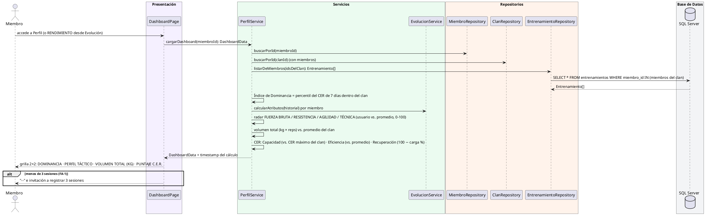
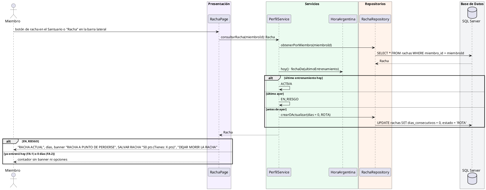
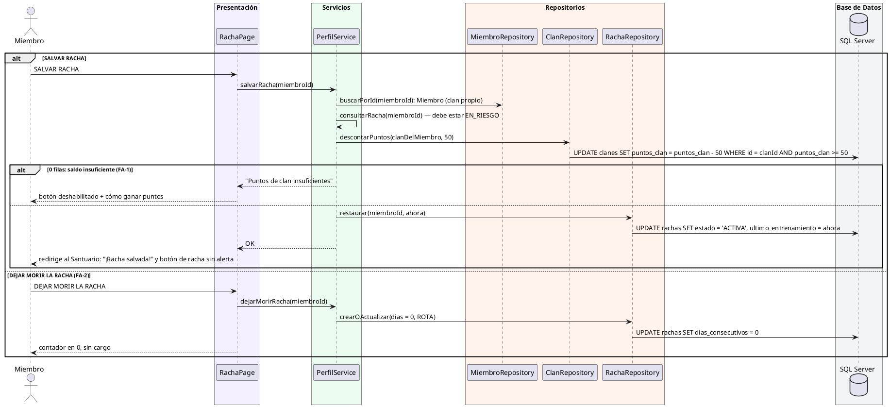
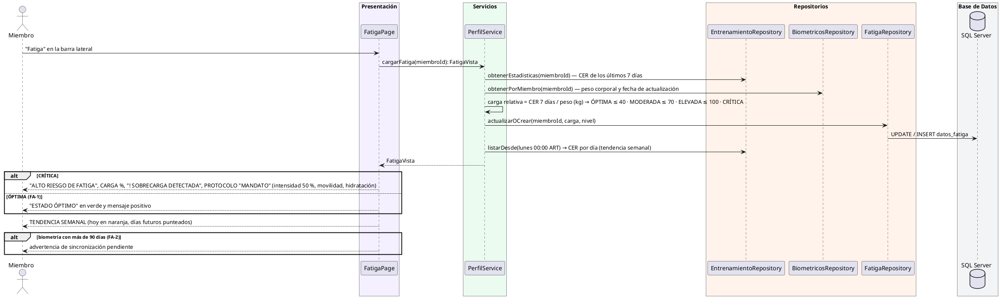
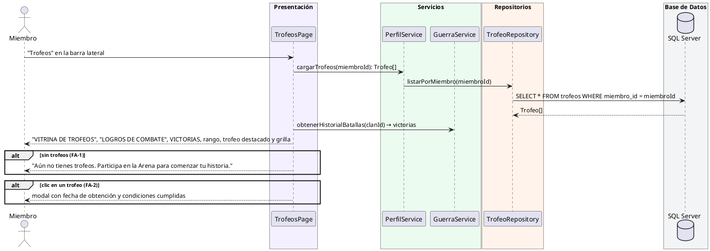
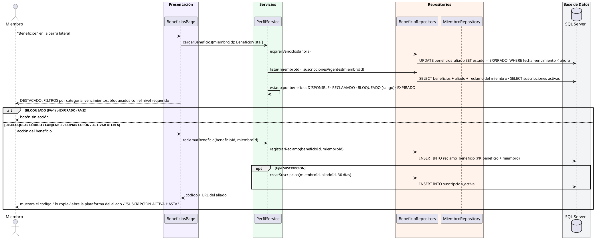
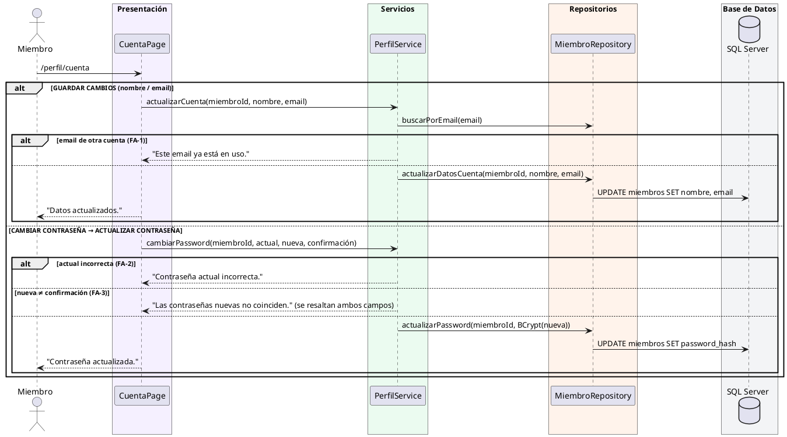

# 10.5.4 — Diagramas de Secuencia: CU-005 PERFIL

**Tipo:** Diagramas de secuencia de diseño (no de sistema)
**Convención:** Page → Service → Repository → SQL Server (DB)
**Actor:** Miembro (usuario estándar)

---

## CU-005 — PERFIL

> **Actualizado 17/11 (alineado con la carpeta):** dashboard comparativo 2×2 (RF-007), racha en hora Argentina con rescate y "DEJAR MORIR LA RACHA", fatiga relativa al peso corporal con protocolo y tendencia (RF-009), vitrina con victorias, beneficios por rango con vencimiento y suscripción (RF-016), cuenta con confirmación de contraseña.

---

### CU-005-001 — Consultar Dashboard de Rendimiento Personal

---

### CU-005-002 — Consultar Racha de Entrenamiento

---

### CU-005-003 — Salvar Racha con Puntos de Clan

---

### CU-005-004 — Monitorear Estado de Fatiga Biométrica

---

### CU-005-005 — Consultar Vitrina de Trofeos

---

### CU-005-006 — Reclamar Beneficio de un Aliado Comercial

---

### CU-005-007 — Gestionar Datos de Cuenta

